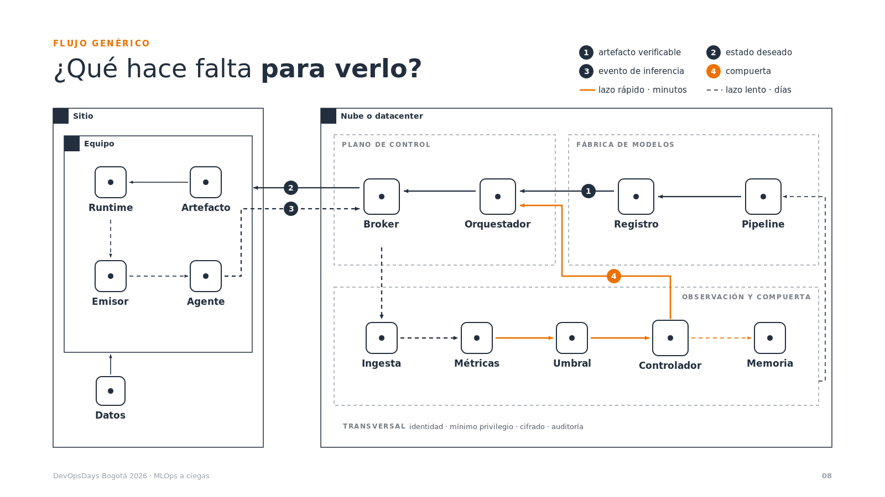
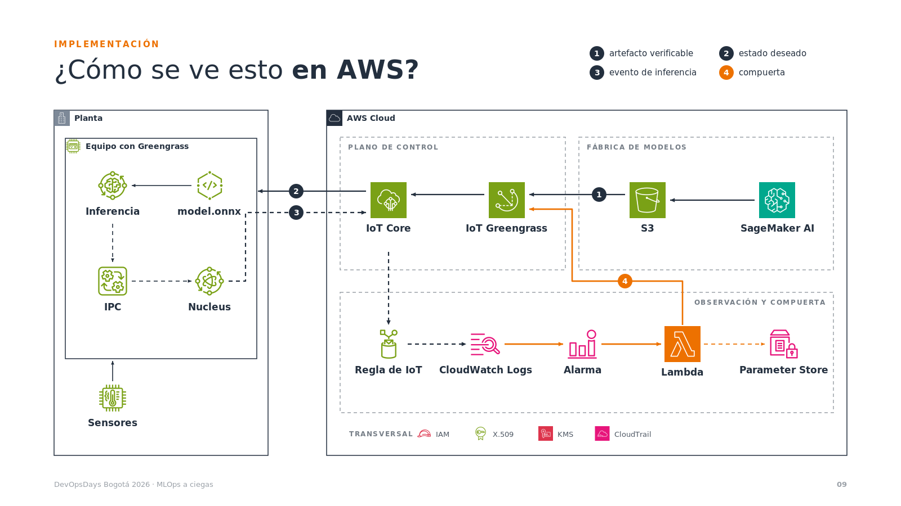
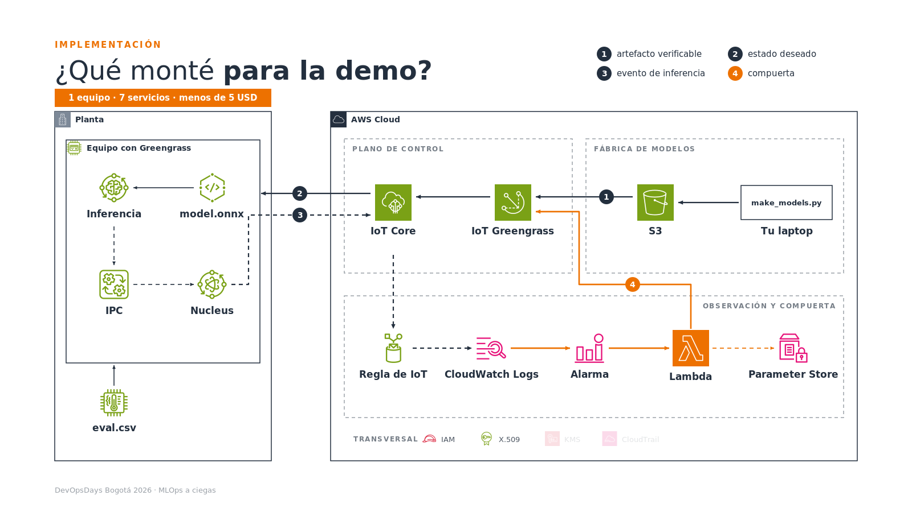

# SPEC · Refactor completo del deck DevOpsDays — *MLOps a ciegas*

**Estado:** implementado en `charla/devopsdays.html` y en `charla/MLOps-a-ciegas-DevOpsDays-Bogota-2026.pptx` (respaldo del tema oscuro en `charla/decks/devopsdays-v1-oscuro.html`) · **Fecha:** 28 sep 2026 · **Actualizado:** 11 oct 2026

> **11 oct 2026 · plantilla oficial de DevOpsDays Bogotá.** El deck pasó a la plantilla de la organización: paleta navy `#071329` / púrpura `#6D28D9` / azul `#2448FF` / cian `#00BCEB`, Calibri (Carlito embebida en el HTML), antetítulo con los tres cuadros, pie con la onda, el logo, el número y devopsdaysbogota.org, portada con el oso y el unicornio, divisores de sección y cierre con los personajes. Se sumaron *Quién soy*, la agenda (reemplaza "Ahora sí"), cuatro divisores, *¿Qué lleva el equipo por dentro?* y *Recursos*: 32 láminas + 6 anexos. Las láminas de la nube, el edge, el equipo y las señales son figuras isométricas (`tools/build_iso.py`). El PowerPoint se arma sobre la plantilla con `tools/pptx/render.sh`. Las secciones §3.1, §3.3 y §3.4 de abajo describen el sistema anterior; mandan los valores de esta nota.

> **11 oct 2026 · segundo giro: gobernar y observar.** La charla deja de centrarse en "nadie ve lo que decide el modelo" y pasa a **cómo gobernar y observar modelos en el edge**. Las láminas ya no nombran a AWS (la demo sigue corriendo en una nube pública, sin nombrarla). Entra la forma de las charlas de Freddy Vega: analogía de apertura ("entrenar un modelo es criarlo; desplegarlo en el edge es dejarlo ir"), tres mitos con datos, preguntas a mano alzada que todos pueden contestar, provocación antes del resumen y cierre que vuelve a la analogía. Contenido nuevo con fuentes: optimización por chip (en el diagrama y en su propia lámina), pasaporte del modelo (firma, ML-BOM, línea base), modo sombra y anillos, regulación (AI Act, NIST AI RMF, ISO/IEC 42001), los cuatro tipos de drift, PSI en el equipo y qué debe contar un modelo (monitores del ML Test Score). 34 láminas + 4 anexos. La tabla de §5 refleja esta versión.

---

## 0. En una página

| Qué | Antes | Después |
|---|---|---|
| Fondo | oscuro, con ondas | **blanco**, sin texturas |
| Colores | 5+ (cian, verde, rojo, grises, blanco) | los de la **plantilla oficial**: navy `#071329` y púrpura `#6D28D9` (antes tinta `#232F3E` y señal `#ED7100`) |
| Logo | EPAM en todas las láminas + "Proprietary & Confidential" | **ninguno** |
| Arquitectura | cajas dibujadas a mano | **íconos oficiales de AWS** (paquete 07312026), generados por script |
| Base del contenido | Gartner + experiencia | Gartner + **los tres artículos de AWS** + documentación de Greengrass |
| Láminas | 8 + 1 anexo | **34 + 4 anexos** (cuatro son divisores), una idea por lámina: mitos, gobernar, observar y demo |
| PoC | `poc-devopsdays/` | la misma, con dos ajustes opcionales (§8) |

Vistas previas reales, renderizadas con los íconos del paquete (`charla/spec-assets/`):

| 10 · Flujo genérico | 11 · En AWS | 12 · La PoC |
|---|---|---|
|  |  |  |

Las tres comparten **la misma geometría**: al pasar del flujo genérico a AWS las casillas vacías se convierten en servicios de AWS sin que nada cambie de lugar.

---

## 1. Qué tomamos de cada artículo (y qué no)

| Artículo | Lo que usamos | Dónde | Lo que dejamos afuera |
|---|---|---|---|
| **What is edge AI?** (AWS, página conceptual) | La definición: decidir en milisegundos sin depender de internet. Los tres componentes de una solución: **modelo, gestión de dispositivos, analítica**. Instalar el modelo a mano en cada equipo no escala. Enviar resultados, no datos crudos. | 03, 05 | Retail y cámaras (restricción de la charla). Productos armados (Panorama, Monitron). **IoT Analytics**, que la página todavía menciona pero salió de soporte el 15 dic 2025. |
| **Architecting offline-first GenAI for edge** (AWS Architecture Blog, 22 jul 2026) | Los **cuatro patrones**: fábrica de modelos en la nube, puente gestionado nube-borde, pila de inferencia autónoma en el borde, mejora continua con retroalimentación. Greengrass como puente. Retroalimentación que se encola en el equipo y se sincroniza cuando hay red. mTLS, mínimo privilegio, cifrado en reposo. | 06, 07, 11, A5 | El detalle del stack GenAI (Ollama, Strands, ChromaDB, QLoRA sobre gpt-oss-20b): es demasiado para DevOpsDays. Aparece en una línea de la 11 ("si el modelo es un LLM, cambia la señal, no el lazo"). |
| **SiMa.ai Edgematic + AWS** (AWS ML Blog, 16 may 2025) | El artefacto que corre en el equipo **no es el que se entrenó**: se exporta a ONNX, se opera el grafo, se **cuantiza de FP32 a INT8** y se compila para el chip. El propio artículo pide verificar la precisión después de cuantizar y medir en el equipo. | 05, 11 | El caso de uso (detección de EPP en video): es de cámaras. Los detalles de Palette/Edgematic. |

**El hallazgo que ancla la charla** (documentación de Greengrass v2, verificado):

- Greengrass **ya revierte solo**: `failureHandlingPolicy` vale `ROLLBACK` por defecto, y `abortConfig` cancela un despliegue cuando fallan demasiados equipos (`FAILED | REJECTED | TIMED_OUT`).
- Greengrass **ya verifica el artefacto**: calcula el digest al crear la versión del componente y el equipo lo recalcula antes de instalar; si no coincide, el despliegue falla.
- Pero una v2 que **se instala bien, arranca bien y se equivoca** es, para Greengrass, un despliegue exitoso. No hay señal que la detenga.

> **La plataforma sabe *cómo* volver. No sabe *cuándo*.** El evento de inferencia y la compuerta le dan ese *cuándo*.

---

## 2. El mapeo que sostiene toda la charla

| # | Pieza (charla) | Patrón del artículo offline-first | Sobre AWS | En la PoC |
|---|---|---|---|---|
| 1 | **Artefacto verificable** | Fábrica de modelos en la nube | SageMaker AI Pipelines → S3 → versión de componente de Greengrass (digest calculado por Greengrass) | `model/make_models.py` → S3 → `create-component-version` (`setup.sh` §2–3) |
| 2 | **Estado deseado** | Puente gestionado nube-borde | *Deployment* de Greengrass sobre un *thing group*; viaja por IoT Core; **el equipo lo trae** | `demo/deploy.sh` |
| 3 | **Evento de inferencia** | Pila de inferencia autónoma en el borde | Componente → IPC `PublishToIoTCore` QoS 1 → cola del nucleus → IoT Core → regla → CloudWatch Logs | `component/inference.py`, `accessControl` de la receta, regla `edgepoc_events` |
| 4 | **Compuerta** | Mejora continua con retroalimentación | Filtro de métrica → alarma → Lambda → Parameter Store → `create-deployment` | `cloud/rollback_lambda.py`, `setup.sh` §5–8 |

**Dos lazos, dicho con honestidad:** el artículo describe el **lazo lento** (retroalimentación → reentrenar, días). La **compuerta** es el **lazo rápido** (minutos) y es el aporte de la charla. Conviven: el rápido protege, el lento mejora.

---

## 3. Sistema visual

### 3.1 Paleta: dos colores sobre blanco

| Rol | Color | Uso | Nunca |
|---|---|---|---|
| Fondo | `#FFFFFF` | todo | — |
| **Tinta** | `#232F3E` | texto, líneas, casillas, flujos normales, "✓" | — |
| **Señal** | `#ED7100` | **una sola cosa por paso**: lo que hay que mirar, el error "✗", la compuerta, el kicker | como relleno de fondo grande |

- Las opacidades de un color cuentan como el mismo color: tinta al 100 / 66 / 45 / 16 / 8 %, señal al 100 / 12 %.
- **Por qué éstos:** la tinta es la del grupo *AWS Cloud* (`#242F3E`) y la señal es el naranja de Lambda. El actor de la compuerta (Lambda) queda del mismo color que la compuerta.
- **Sin semáforo verde/rojo.** Bien = tinta + "✓", mal = señal + "✗". Forma y color a la vez: se lee igual con daltonismo y en un proyector lavado.

### 3.2 La única excepción: los íconos de AWS

- Van con **sus colores oficiales y sin modificar** (verde IoT/S3, rosa CloudWatch/SSM, naranja Lambda, turquesa SageMaker). Recolorearlos les quita lo que los hace reconocibles.
- **Solo aparecen en las láminas de AWS, de la PoC y en A2.** Fuera de esas láminas, la regla de dos colores es estricta.
- En la PoC los colores de ícono se reducen a tres: verde, rosa y el naranja que ya es la señal.

### 3.3 Tipografía (sin fuentes web: el deck funciona sin internet)

| Uso | Familia | Tamaño en lienzo 1600×900 | Peso |
|---|---|---|---|
| Kicker | sistema | 15 px, mayúsculas, espaciado 0,16 em, **señal** | 700 |
| Título | sistema | 46–60 px; la parte clave en negrita | 300 + 700 |
| Cuerpo | sistema | ≥ 24 px | 400 |
| Rótulo de diagrama | sistema | 17 px, una sola línea (el detalle va a los anexos) | 600 |
| Código y datos | `ui-monospace, SF Mono, Menlo, Consolas` | 18–20 px | 500 |

- Sistema = `-apple-system, "Segoe UI", Helvetica, Arial, sans-serif`.
- Los diagramas son densos por naturaleza. Se compensa con **foco por paso**: lo que no se está explicando baja al 16 % y la sala sólo lee 2 o 3 rótulos a la vez.

### 3.4 Retícula

- Lienzo 1600×900, escalado con `transform: scale` (como hoy).
- Márgenes laterales de 96 px.
- Kicker en y = 84, título en y = 140, leyenda arriba a la derecha (x ≥ 1040).
- Contenido entre y = 196 y y = 810.
- Pie en y = 866: a la izquierda "DevOpsDays Bogotá 2026 · MLOps a ciegas" (tinta 45 %), a la derecha el número de lámina.

### 3.5 Qué se elimina

- Logo EPAM (todas), pie "EPAM Proprietary & Confidential", "· EPAM" en portada y cierre (ver decisión D1).
- El tema oscuro, las ondas de fondo (`canvas.wave`), brillos, degradés y sombras.
- Las fichas de colores de la genérica (se reemplazan por la leyenda 1–4).

### 3.6 Piezas del sistema

- **Kicker + título:** título en peso 300, con la parte clave en 700.
- **Leyenda de piezas:** círculos 1–4 en tinta; el 4 en señal.
- **Grupo estilo AWS:** borde de 1,5 px, cuadrado de 28 px con ícono en la esquina y rótulo a su lado. Subgrupos punteados, rótulo en mayúsculas al 62 %.
- **Casilla** (genérica): cuadrado redondeado con punto central. Es el lugar donde después va el ícono.
- **Flecha:** sólida = control o artefacto; punteada = evento; en señal = compuerta.
- **Sello:** bloque de señal con texto blanco. Uno por deck (lámina de la PoC, debajo del título).
- **Tarjeta:** borde superior de 2 px en tinta; la destacada con borde superior en señal.

---

## 4. Movimiento

### Principios

1. **Un clic, una idea.** Nada se mueve sin razón.
2. **Una sola cosa en señal por paso.**
3. **Foco:** lo que no se explica baja al 16 % en 300 ms.
4. Entradas de 400 ms en *ease-out*. Sin rebotes ni giros.
5. **Flujos** que se dibujan (`stroke-dashoffset`), y después **paquetes**: puntos de 6 px que recorren el camino. Tinta para eventos, señal para la reversión.
6. Con `prefers-reduced-motion`: sin paquetes y pasos instantáneos.

### Motor

- Se mantiene el motor actual: clic o → avanza el paso antes de la lámina; A anexos, M volver, N notas, F pantalla completa, R reinicia.
- **Se agrega soporte SVG:** `data-on="2-"` (visible desde el paso 2), `data-focus="3"` (en foco en el paso 3; el resto se atenúa) y `data-flow="evt"` (flujo animable).
- **Canvas** para las 100 computadoras, los memes, el tablero y la línea de tiempo de la demo, todos a dos colores.
- **Morph flujo genérico → AWS:** la lámina de AWS arranca en el paso 0 idéntica a la genérica, sin el lazo lento. En el paso 1 las casillas se funden a íconos de izquierda a derecha (desfase escalonado hasta 0,6 s) y los rótulos cambian.
- **Impresión:** `@media print` saca cada lámina en su paso final, para exportar a PDF para la organización.

---

## 5. Estructura y lámina por lámina

**Regla:** una idea por lámina. El detalle va a las notas del presentador (tecla N) o a los anexos.

**El guion manda.** `charla/GUION-devopsdays.md` sigue la forma de la charla de referencia (Prime Video): apertura con lo que todos esperan, tres números de dos firmas, tres momentos de reflexión, el censo del pager, "ahora sí empieza", una historia Día 1 / Día 3, el antes y el después, y cierre con lo que se llevan. Cada sección del guion es la nota de su lámina: `build_deck.py` la copia por `data-id`.

| # | Momento | Título | Clics |
|---|---|---|---|
| 01 | Apertura | MLOps **a ciegas** · portada | — |
| 02 | Apertura | Entrenar un modelo es criarlo. Desplegarlo en el edge es **dejarlo ir**. | 1 |
| 03 | Gancho | ¿Cuántas PC nuevas traen **chip para IA**? · 16 → 31 → 55 | 2 |
| 04 | Gancho | ¿Cuánto dinero se está invirtiendo **en edge**? · IDC 261 → 380 | — |
| 05 | Gancho | ¿Por qué la IA se está **saliendo de la nube**? · tres memes | 2 |
| 06 | Apertura | Quién soy | — |
| 07 | Agenda | ¿Qué van a **aprender hoy**? | — |
| 08 | Divisor 01 | Tres mitos | — |
| 09 | Mito 1 | ¿El modelo que corre es **el que entrenaste**? · 1 de 3 fallas de conversores; 4× al cuantizar | 3 |
| 10 | Mito 2 | ¿Si funcionó en las pruebas, **va a seguir funcionando**? · 91 % se degrada; +20 % de imágenes rechazadas | 3 |
| 11 | A mano alzada 1 | «Si no suena el pager, **todo está bien**.» | — |
| 12 | Mito 3 | ¿Si el panel está en verde, **el modelo está bien**? · Día 1 97 % → Día 3 61 % | 2 |
| 13 | Divisor 02 | Gobernar | — |
| 14 | Gobernar | ¿Qué lleva el equipo **por dentro**? · vista explotada | 3 |
| 15 | Gobernar | ¿Qué hace falta **para gobernarlo**? · cinco piezas, la primera es optimizar por chip | 6 |
| 16 | Gobernar | ¿Qué cambia cuando lo optimizas **para el chip**? · un artefacto por chip | 3 |
| 17 | Gobernar | ¿Qué tiene que viajar **con el modelo**? · pasaporte | 2 |
| 18 | Gobernar | ¿Cómo lo despliegas en mil equipos **sin romper nada**? · sombra, anillos, vuelta sola | 2 |
| 19 | A mano alzada 2 | ¿Quién ha hecho un rollback **un viernes en la tarde**? | — |
| 20 | Gobernar | ¿Quién más te va a pedir **estas cuentas**? · AI Act, NIST, ISO 42001 | 3 |
| 21 | Divisor 03 | Observar | — |
| 22 | Observar | ¿Qué tenemos cuando el modelo corre **en la nube**? | — |
| 23 | Observar | ¿Y cuando el modelo baja **al edge**? · 4 razones | 4 |
| 24 | A mano alzada 3 | ¿Quién sabe qué versión **está corriendo ahora mismo**? | — |
| 25 | Observar | ¿Qué pasa cuando **el mundo cambia**? · data, concept, prediction drift y skew | 3 |
| 26 | Observar | ¿Cómo mides el drift **sin mandar los datos**? · PSI en el equipo, CBPE | 3 |
| 27 | Observar | ¿Qué debería contarte **un modelo**? · seis capas | 6 |
| 28 | Divisor 04 | En vivo | — |
| 29 | En vivo | ¿Cuáles son las señales doradas **de un modelo**? | — |
| 30 | En vivo | ¿Cómo se ve un modelo **decidiendo**? · y las terminales | 3 |
| 31 | Cierre | ¿Qué me llevo **hoy**? · cinco cosas | 4 |
| 32 | Cierre | Dejar ir no es **dejar de mirar**. | — |
| 33 | Cierre | ¿Dónde sigo **después de la charla**? | — |
| 34 | Cierre | Gracias | — |

Anexos: A1 el evento de la demo · A2 de la demo a producción · A3 qué método de drift usar · A4 fuentes.

La vuelta automática ahora vive en la lámina 18 (anillos) y "qué falta para producción" en el anexo A2.

Tiempos y cortes (35, 30 y 25 min): al final del guion. Vista general: `spec-assets/estructura.png`.

### Lo que salió de la pantalla (y adónde fue)

| Lámina | Qué se quitó | Dónde quedó |
|---|---|---|
| 02 | "traen un chip para IA" (ya lo dice el título) y la línea del software | la línea del software es ahora la lámina 03 |
| 04 | la línea de Siemens, los rótulos "decide en el equipo", "INTERNET" y "modelo en el equipo · sin red" | notas (Siemens) · el dibujo ya lo muestra |
| 05–06 | las descripciones de cada parte y las etiquetas "esto es DevOps" | notas: "dos de las tres partes son DevOps" |
| 08 | "Decide: …" y "Si se equivoca callado: …" | notas |
| 09 | la línea de detalle de cada razón | notas |
| 10–12 | segunda línea de cada nodo, textos largos de la franja transversal, fuentes bajo el título | anexos A2–A4 y pie de lámina |
| 13 | el dato "latencia: igual" | lo dices en voz alta |
| 14 | la métrica de AWS de cada tarjeta | notas |
| 15 | la columna de fuentes y los nombres de API | notas y anexo A5 |
| 16 | la línea "el código de la demo · fuentes en A5" | — |

### Los memes (lámina 04)

Son escenas animadas y originales, con formatos de texto de meme ("Nadie: …"). Cada una tiene dos paneles: **preguntarle a la nube** ✗ contra **decidir en el equipo** ✓.

| # | El meme | Remate en pantalla | Fuente del caso |
|---|---|---|---|
| 1 | "Nadie: / El carro autónomo: «dame un segundo, se lo pregunto a la nube»" | **Latencia:** la ida y vuelta no alcanza | AWS · What is edge AI? |
| 2 | "Técnico, 3 a. m.: «¿cómo cambio este rodamiento?» / La nube: «Sin conexión. Intente más tarde.»" | **Sin conexión:** igual tiene que responder | AWS Architecture Blog, jul 2026 |
| 3 | "Tu reloj, cada segundo: «subiendo tus latidos a internet…»" | **Privacidad:** lo sensible no sale del equipo | AWS · What is edge AI? |

No uso imágenes de memes reales: son fotos o personajes con derechos de otros, y se proyectan en un evento público.

### Anexos (A para entrar, M para volver)
A1 ¿Qué declara el modelo? · A2 ¿Cómo vuelve atrás, llamada por llamada? · A3 ¿Qué revierte Greengrass solo? · A4 ¿Qué permisos pide y cuánto cuesta? · A5 Fuentes. Son material de consulta para las preguntas, por eso tienen más texto.

---

## 6. Cómo se construye la arquitectura (reproducible)

- `charla/tools/aws_icons.py` lee los SVG del paquete oficial (`AWS_ICONS=…/Icon-package_07312026`).
  - Les quita `<title>` e `id`, y no toca ni geometría ni color.
  - `python3 aws_icons.py` lista cada ícono con sus colores.
- `charla/tools/build_arch.py` genera `arq-generica.svg`, `arq-aws-referencia.svg` y `arq-aws-poc.svg` desde **una sola tabla de nodos**. Por eso la geometría es idéntica.
  - Los flujos llevan `data-flow` (`art`, `des`, `evt`, `gat`, `slow`) para que el motor los anime.
- `charla/tools/build_seq.py` genera la secuencia del A2.
- `charla/tools/build_deck.py` arma `charla/devopsdays.html` desde `charla/tools/deck.src.html`: un solo archivo, sin referencias externas y funcional sin internet. **No edites el HTML generado: edita `deck.src.html` y volvé a correr el script.**

**Íconos en los diagramas de arquitectura:** 21, de un paquete de más de 4.000 archivos.

| Tipo | Íconos |
|---|---|
| Servicio | IoT Greengrass, IoT Core, S3, SageMaker AI, Lambda, KMS, CloudTrail |
| Recurso | Greengrass Component-ML, Artifact, Nucleus, IPC, IoT Rule, Certificate, Thing Industrial-PC, Thing Temperature-Vibration-Sensor, CloudWatch Logs, CloudWatch Alarm, Parameter Store, IAM Role |
| Grupo | AWS Cloud, Corporate data center |
| Reservados para A2 | CloudWatch, Systems Manager, IAM (servicio) |
| Reservado para A5 | Bedrock |

---

## 7. Estado de la implementación

| Paso | Qué | Estado |
|---|---|---|
| 1 | Respaldo del deck oscuro en `charla/decks/devopsdays-v1-oscuro.html` | hecho |
| 2 | Plantilla nueva: sistema visual, pie con los seis bloques, motor con soporte SVG | hecho |
| 3 | Los tres diagramas desde `build_arch.py`, con construcción, foco, fundido y puntos en las flechas | hecho |
| 4 | Canvas a dos colores: 100 computadoras, tres memes, tablero y demo | hecho |
| 5 | Resto de láminas + anexos A1–A5, con notas del presentador; pasada de aligerado (§5) | hecho |
| 6 | QA (§9) | hecho, salvo lo que sólo se ve en tu navegador (ver §9) |

Para regenerar: `AWS_ICONS=~/Downloads/Icon-package_07312026 python3 charla/tools/build_deck.py` (con `REPO_URL=…` agrega el QR).

---

## 8. Ajustes a la PoC (opcionales)

| Ajuste | Por qué | Costo | Riesgo |
|---|---|---|---|
| **a. Dataset industrial sintético** en lugar de iris: tres rasgos (vibración RMS, temperatura, corriente) y tres clases (normal, desbalance, rodamiento). La v2 se degrada igual. | Que la demo hable el mismo idioma que las láminas ("sensores del proceso") y que el caso de manufactura de AWS. Se dice "sintético" en voz alta. | ~1 h | Hay que volver a medir: v1 ≤ 3 errores/min y v2 entre 6 y 19. |
| **b. Rol de la Lambda acotado** a las acciones que exige `CreateDeployment` | Que el A4 muestre la versión de producción, no sólo la advertencia | 30 min | Validar el día 4 con la reversión real |
| **c. Demo sin red (bonus, fuera de la charla)** con DiskSpooler: se desconecta el equipo, sigue infiriendo y al volver llegan los eventos | Material para preguntas o video | 1 h | No hacerlo en vivo |

Pendientes que no cambian: medir **⟨XX⟩ s** tres veces y publicar el repo para reemplazar `⟨usuario⟩`.

---

## 9. Criterios de aceptación (resultado)

- [x] **Paleta:** el script revisa todo `#hex` y `rgb()` propio del HTML; sólo aparecen `#FFFFFF`, `#232F3E` y `#ED7100` (y sus transparencias). Los íconos AWS quedan excluidos por marca.
- [x] **Cero** apariciones de `EPAM`, `Confidential`, `kubectl`, `cámara`/`camera` en el deck.
- [x] Cada número en pantalla tiene su fuente en la lámina o en A5.
- [x] Los tres diagramas se regeneran desde el paquete oficial con un comando.
- [x] Un solo archivo HTML, sin recursos externos, 350 KB.
- [x] Motor probado en jsdom: 25 láminas, pasos por lámina, anexos (A/M), "atrás" entra al último paso, sin errores de JS.
- [x] Render estático de cada lámina (WeasyPrint + grabador de canvas) y revisión visual; se corrigieron el pie que se partía, el arco de la 05, los rótulos de la demo y el sello de la PoC.
- [ ] **Sólo en tu navegador:** las transiciones, los puntos que recorren las flechas, la tipografía real (SF) y la impresión a PDF. No tengo un navegador con el que abrir archivos locales.
- [x] Notas del presentador en todas las láminas. *Placeholders*: `⟨XX⟩` (anexo A2), `⟨usuario⟩` (lámina 25), y en el guion tu rol, un dato personal y tu anécdota.

---

## 10. Fuentes

1. AWS Architecture Blog — *Architecting offline-first generative AI applications for edge deployments using AWS services* (22 jul 2026). https://aws.amazon.com/blogs/architecture/architecting-offline-first-generative-ai-applications-for-edge-deployments-using-aws-services/
2. AWS — *What is edge AI?* https://aws.amazon.com/what-is/edge-ai/
3. AWS Machine Learning Blog — *Accelerate edge AI development with SiMa.ai Edgematic with a seamless AWS integration* (16 may 2025). https://aws.amazon.com/blogs/machine-learning/accelerate-edge-ai-development-with-sima-ai-edgematic-with-a-seamless-aws-integration/
4. Gartner — *AI PCs will represent 31 % of worldwide PC market by the end of 2025* (28 ago 2025), tabla 1: 15,6 / 31,0 / 54,7 %. https://www.gartner.com/en/newsroom/press-releases/2025-08-28-gartner-says-artificial-intelligence-pcs-will-represent-31-percent-of-worldwide-pc-market-by-the-end-of-2025
5. IDC — *Worldwide Edge Computing Spending Guide* (17 mar 2025): US$ 261.000 M en 2025 → US$ 380.000 M en 2028; América Latina entre las de crecimiento más rápido. https://my.idc.com/getdoc.jsp?containerId=prUS53261225
6. AWS IoT Greengrass v2 API — `DeploymentPolicies` (`failureHandlingPolicy` = `ROLLBACK` por defecto). https://docs.aws.amazon.com/greengrass/v2/APIReference/API_DeploymentPolicies.html
6. AWS IoT Greengrass v2 API — `IoTJobAbortCriteria` (`FAILED | REJECTED | TIMED_OUT | ALL`). https://docs.aws.amazon.com/greengrass/v2/APIReference/API_IoTJobAbortCriteria.html
7. AWS IoT Greengrass v2 — Referencia de receta, campo `Digest`. https://docs.aws.amazon.com/greengrass/v2/developerguide/component-recipe-reference.html
8. AWS IoT Greengrass v2 — Componente nucleus, `mqtt.spooler` (Memory por defecto, 2,5 MB; Disk desde v2.11.0; QoS 1 siempre se encola). https://docs.aws.amazon.com/greengrass/v2/developerguide/greengrass-nucleus-component.html
9. AWS IoT Analytics — fin de soporte 15 dic 2025. https://docs.aws.amazon.com/iotanalytics/latest/userguide/iotanalytics-end-of-support.html
10. AWS Architecture Icons — paquete 07312026 (uso permitido en diagramas y presentaciones). https://aws.amazon.com/architecture/icons/

---

## 11. Decisiones que necesito de ti

| # | Decisión | Opciones | Recomiendo |
|---|---|---|---|
| D1 | Afiliación en portada y cierre (el logo sale igual) | "Alejandro Varela" · "Alejandro Varela · EPAM" | Sólo el nombre (así quedó) |
| D2 | Dataset de la PoC | iris (ya probado) · sintético industrial (§8a) | Sintético industrial |
| D3 | Duración del espacio | 35 min completa · 30 o 25 min (cortes del guion) | La que te haya dado la organización; el deck trae las dos |
